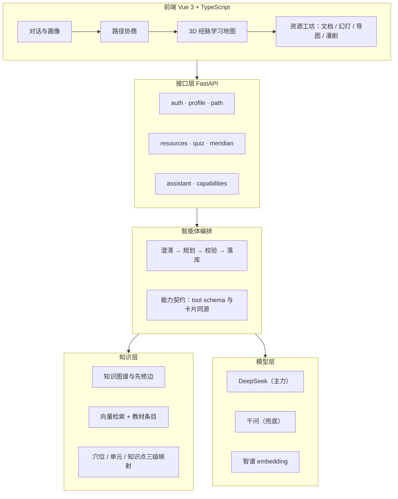

# 岐黄智学 · 中医药个性化学习多智能体系统

中医本科生的一句话，被翻译成一条可执行的学习路径：**"我是中药学专业的，方剂这块薄弱，两周后考试。"** 系统读完学生档案、对齐这句话，给出写明"哪些跳过、哪些必学、每段多少时间"的路线，再把这条路线画到一张 3D 人体经脉图上。课程里的 293 个穴位对应 293 个学习单元，测评通过，穴位才亮。

- 在线演示：<http://8.138.38.62/>
- 演示账号：`disciple_a` / `disciple_b` / `disciple_c`，密码均为 `demo1234`
- 参赛赛道：全国大学生计算机应用能力与数字素养大赛暨第九届传智杯全国大学生数智创新与 AI 应用大赛 · 技术应用赛 · AI WEB 网页开发挑战赛（B 组）

工程源码在 `qihuang-zhixue/` 目录下，前后端同仓，前端 `frontend/`、后端 `backend/`。

---

## 目录

- [一、项目做了什么](#一项目做了什么)
- [二、技术架构](#二技术架构)
- [三、安装与运行](#三安装与运行)
- [四、环境配置](#四环境配置)
- [五、目录结构](#五目录结构)
- [六、文档与数据来源](#六文档与数据来源)
- [七、团队信息](#七团队信息)

---

## 一、项目做了什么

### 起点是一个具体的困难

中医本科要学六门核心课：中医基础理论、中医诊断学、中药学、方剂学、中医内科学、针灸学，合计 96 章、954 个知识点。这些知识点彼此引用得很紧：学到麻黄汤，同时要用到中药学的性味归经、方剂学的配伍原则和诊断学的证候判断，而这三门课往往排在不同学期。学生脑子里拼不起来这张网，只能按章节线性往前推。

再加上两件事：同一份教学进度下，已掌握的学生在重复，薄弱的学生在反复卡住，教师没有低成本手段区分二者；作业与阶段测验以周计，等成绩返回来，遗忘已经发生，纠错成本被时间放大。

所以这个系统不去做"更全的资料库"，而是做"更准的判断"：判断学生现在在哪、下一步该学什么、哪些不必再学。

### 系统怎么做的

一句话概括：把六门课的全部知识点挂到一张能走的人体经脉图上，让每个学生只学自己缺的那一段。

这句话拆开是四件事，也是系统的四条主线：

| 主线 | 做的事 | 落在哪个模块 |
| --- | --- | --- |
| 诊断 | 通过对话与做题取证，形成七维画像，不填量表 | `backend/app/profile`、`app/quiz` |
| 规划 | 在知识依赖与时间预算之间做取舍，给出跳过 / 必学清单 | `backend/app/path`、`app/agents` |
| 学习 | 在 3D 经脉地图上逐穴进入，边学边生成成品 | `frontend/src/views`、`app/resources` |
| 验证 | 测评通过才点亮穴位，掌握度与复习计划随之更新 | `app/mastery`、`app/quiz` |

四条主线首尾相接，结果写回画像，下一轮规划据此重排。系统不把"学过了"当作"学会了"，只有测评通过，穴位才会由灰转亮。

### 现在完成到什么程度

| 维度 | 现状 |
| --- | --- |
| 课程覆盖 | 6 个学科、96 章、293 个学习单元、954 个知识点，全部挂到穴位 |
| 经脉模型 | 670 个穴位点位、26 条经脉，几何取自 BodyParts3D（CC BY 4.0） |
| 教材依据 | 445 条教材条目，供检索增强与依据标注使用 |
| 能力契约 | 20 项可调用能力，含文档、幻灯、思维导图、漫剧等成品生成 |
| 工程质量 | 后端 1709 条自动化用例，前端 24 个组件契约脚本 |
| 部署状态 | 已在云服务器部署、公网可访问，健康检查返回 `{"status":"ok","service":"qihuang-backend"}` |

---

## 二、技术架构

### 分层



### 主要选型及理由

| 位置 | 选型 | 为什么 |
| --- | --- | --- |
| 后端 | FastAPI + Pydantic v2 | 能力契约要靠 schema 驱动，Pydantic 模型直接派生 tool schema 与前端卡片，避免两处手写 |
| 编排 | LangGraph | 规划是多阶段带状态回退的流程（澄清 → 提案 → 校验 → 重试），用图描述比线性链好排查 |
| 检索 | ChromaDB | 单机持久化、零运维，够 445 条教材条目的规模；要换 PG 或云向量库只改一层 |
| 存储 | SQLite | 演示与评审优先可复现，一个文件即全部数据；接口层没有写死方言 |
| 前端 | Vue 3 + TypeScript + Vite | 页面与组件数量大，TS 在重构期能挡住大半误改；Vite 冷启动快 |
| 3D | Three.js | 经脉与穴位需要自定义几何、拾取与后期效果 |
| 图谱 | AntV G6 | 知识图谱要可拖拽、可下钻、可对比，G6 的布局与交互开箱可用 |
| 图表 | ECharts | 雷达图、进度与统计图 |
| 成品生成 | simple-mind-map / pptxgenjs / markdown-it | 导图、幻灯、文档三类成品在浏览器端直接可编辑 |

### 三个关键设计

**1. 能力只有一份声明。** 每一项可调用能力都由一个 `CapabilitySpec` 描述，tool schema、前端能力卡、`docs/capabilities.md` 全部从它派生。改能力只改一处，不会出现"文档说有、接口没有"。

**2. 模型给的计划必须过校验。** 路径提案落库前跑八条检查：顺序错、考点覆盖不足、裁剪过度属于整单拒绝（重试上限两次，仍不过则回退到规则底稿）；层号回退、先修缺失、掌握度越界等属于单条拒绝。置信度取画像实测值，不采信模型自报的数字。

**3. 每条结论都带依据。** 知识点依据分三档：`textbook`（教材原文条目）、`graph`（图谱推理）、`model`（模型推断）。只有 `model` 档会在界面上打"推断"角标，学生能看出哪些结论有硬依据。

数据流只有一条：前端一次请求 → 接口层取上下文 → 编排层决定调哪个能力（可能带检索）→ 产物与依据一起落库 → 前端按契约渲染。中间不写第二份真值。

---

## 三、安装与运行

### 环境要求

| 组件 | 版本 | 说明 |
| --- | --- | --- |
| Python | 3.12（开发用 3.12.9） | 3.11 及以上理论可运行，未做回归 |
| Node.js | 22（开发用 22.22.2） | 需要 npm 10 |
| 浏览器 | Chrome / Edge 最新版 | 3D 经脉场景需要 WebGL2 与浮点渲染目标 |
| 数据库 | 无需安装 | SQLite 文件，首次启动自动建表 |

### 启动后端

```bash
cd qihuang-zhixue/backend
python -m venv .venv
# Windows
.venv\Scripts\activate
# macOS / Linux
# source .venv/bin/activate

pip install -r requirements.txt
cp .env.example .env        # Windows 用 copy .env.example .env
uvicorn app.main:app --reload --host 127.0.0.1 --port 8000
```

`.env` 里至少要填一个模型 key（`DEEPSEEK_API_KEY` 或 `QWEN_API_KEY`）。不填也能启动：`LLM_FALLBACK_TO_MOCK=true` 时模型调用回退到内置样例，流程能完整走通，只是内容不是真生成。

健康检查：

```bash
curl http://127.0.0.1:8000/health
# {"status":"ok","service":"qihuang-backend"}
```

初始化演示账号（密码均为 `demo1234`）：

```bash
python -m app.auth.seed
```

数据库默认落在 `backend/.data/qihuang.db`，可用 `QIHUANG_DB_PATH` 覆盖，相对路径按 `backend/` 解析。

### 启动前端

```bash
cd qihuang-zhixue/frontend
npm ci
npm run dev
```

访问 <http://127.0.0.1:5173>。Vite 已配好代理：`/api` 与 `/health` 转发到 `127.0.0.1:8000`。后端换了端口不用改配置文件：

```bash
QH_API_TARGET=http://127.0.0.1:8010 npm run dev
```

### 跑测试

```bash
# 后端：会起临时 SQLite 与录制回放，不烧模型额度
cd qihuang-zhixue/backend
pytest

# 前端组件契约
cd qihuang-zhixue/frontend
npm test

# 类型检查 + 构建
npm run build
```

前端还有一个图谱交互的端到端脚本：`npm run test:e2e:graph`（需先起前后端）。

### 部署到服务器（参考）

前端构建成静态文件由 nginx 托管，后端用 uvicorn 常驻。要点只有三处：

```bash
# 1. 构建（产物在 frontend/dist）
cd qihuang-zhixue/frontend && npm ci && npm run build

# 2. 后端常驻（工作目录 backend/）
.venv/bin/uvicorn app.main:app --host 127.0.0.1 --port 8000
```

```nginx
# 3. nginx 的关键三段
location /api/   { proxy_pass http://127.0.0.1:8000; }
location /health { proxy_pass http://127.0.0.1:8000; }
location /       { try_files $uri $uri/ /index.html; }
```

生产环境必做两件事：`AUTH_SECRET` 换成随机长字符串（用默认值时后端启动会告警），`.env` 不进仓库。

---

## 四、环境配置

变量清单、默认值与逐项说明见 **[ENVIRONMENT.md](ENVIRONMENT.md)**，里面同时给了依赖清单与常见配置故障。这里只放最小可用集：

```dotenv
# qihuang-zhixue/backend/.env —— 三项先填掉
DEEPSEEK_API_KEY=sk-xxxxxxxx
AUTH_SECRET=<随机长字符串>
QIHUANG_DB_PATH=backend/.data/qihuang.db
```

变量分四组，容易混的几处先说清楚：

| 组 | 变量 | 作用 |
| --- | --- | --- |
| 模型 | `LLM_PROVIDER`、`DEEPSEEK_*`、`QWEN_*`、`ZHIPU_API_KEY`、`EMBEDDING_*` | 主力模型、兜底模型、向量化 |
| 运行模式 | `LLM_MODE`（`live` / `replay` / `auto` / `mock`） | 测试脚本请显式设 `replay`，否则会真调模型 |
| 推理开关 | `LLM_THINKING_DEFAULT` | 默认关闭；抽取、分类、评分不需要推理 token |
| 安全与存储 | `AUTH_SECRET`、`AUTH_TOKEN_EXPIRE_DAYS`、`QIHUANG_DB_PATH`、`CORS_ORIGINS` | 登录签名、有效期、库路径、跨域白名单 |

`LLM_MODE` 是一套录制回放机制：`live` 真调并录制，`replay` 只回放（命中不到直接报错），`auto` 先回放再真调，`mock` 强制假数据。后端 1709 条用例能在不花钱的情况下跑完，靠的就是它。

---

## 五、目录结构

```text
tcm-edu-platform/
├─ qihuang-zhixue/          工程源码
│  ├─ backend/              FastAPI 后端
│  │  ├─ app/
│  │  │  ├─ agents/         编排：澄清、规划、校验、资源方案
│  │  │  ├─ assistant/      对话助手：桥接、循环、工具暴露
│  │  │  ├─ capabilities/   能力契约（20 项）与文档生成
│  │  │  ├─ path/           学习路径：单元解析、取舍、L1/L2 计划
│  │  │  ├─ profile/        七维画像：取证、融合、评分
│  │  │  ├─ quiz/ mastery/  测评、掌握度与复习调度
│  │  │  ├─ kg/ meridian/   知识图谱、经脉与穴位几何
│  │  │  ├─ resources/ ppt/ 资源生成与幻灯母版
│  │  │  ├─ immersive/ mindmap/  沉浸式阅读、思维导图
│  │  │  ├─ llm/            模型接入、录制回放、路由
│  │  │  └─ api/            HTTP 路由
│  │  ├─ data/              经脉几何、教材条目、题库等运行数据
│  │  ├─ scripts/           数据管道与评测脚本
│  │  └─ tests/             后端测试
│  ├─ frontend/             Vue 3 前端
│  │  ├─ src/views/         34 个页面
│  │  ├─ src/components/    按模块分组的组件
│  │  ├─ src/styles/        设计令牌（tokens.scss）
│  │  ├─ public/fonts/      字体子集与许可
│  │  └─ tests/             组件契约脚本
│  ├─ docs/                 设计文档（能力契约、图谱、工坊规范等）
│  └─ tools/                素材入库与审计工具
├─ ENVIRONMENT.md           环境变量模板与依赖清单
└─ README.md                本文件
```

---

## 六、文档与数据来源

### 设计文档

| 文档 | 内容 |
| --- | --- |
| [qihuang-zhixue/docs/capabilities.md](qihuang-zhixue/docs/capabilities.md) | 20 项能力契约（由代码生成，不要手改） |
| [qihuang-zhixue/docs/knowledge-graph-redesign.md](qihuang-zhixue/docs/knowledge-graph-redesign.md) | 知识图谱结构与重构方案 |
| [qihuang-zhixue/docs/graph-visual-spec.md](qihuang-zhixue/docs/graph-visual-spec.md) | 图谱视觉与交互规范 |
| [qihuang-zhixue/docs/intelligent-learning-module.md](qihuang-zhixue/docs/intelligent-learning-module.md) | 学习模块设计 |
| [qihuang-zhixue/docs/studios/](qihuang-zhixue/docs/studios/) | 文档、幻灯、导图、漫剧四个工坊的规范 |
| [ENVIRONMENT.md](ENVIRONMENT.md) | 环境变量模板与依赖清单 |

### 数据与素材来源

- **经脉与穴位几何**：BodyParts3D（Database Center for Life Science, Japan），CC BY 4.0，经 JICio/tcm-3d 适配与吸附后重新打包。仓库只保留浏览器实际加载的压缩几何 `backend/data/meridian/*.gz`。穴位坐标为开源社区人工标定，未经临床校核。
- **教材条目**：由项目成员从公开教材整理为结构化条目，仅用于学习路径的依据标注，版权归原作者与出版机构。
- **字体**：霞鹜文楷（LXGW WenKai）、思源黑体 / 宋体（Noto Sans SC / Noto Serif SC），均为 SIL Open Font License，子集化后放在 `frontend/public/fonts`，许可原文见该目录下的 `LICENSES`。
- **模型服务**：DeepSeek、阿里云百炼（千问）、智谱开放平台。仓库不包含任何密钥。

---

## 七、团队信息

| 项目 | 内容 |
| --- | --- |
| 学校 / 学院 | 广东东软学院 · 人工智能学院 |
| 参赛组别 | B 组 |
| 团队成员 | 叶国淼、殷宸皓、陈俊佺 |
| 指导教师 | 杨雨倩、宋雨婷 |
| 代码仓库 | <https://github.com/miaoye800/tcm-edu-platform> |
| 在线演示 | <http://8.138.38.62/> |

---

## 声明

本项目为参赛作品，用于比赛评审与学习交流。系统内的中医内容属于教学演示，不构成任何诊疗建议。教材条目的著作权归原作者与出版机构，如涉版权问题请联系我们删除。仓库不含用户数据与第三方密钥，演示环境中的账号均为预置测试账号。
